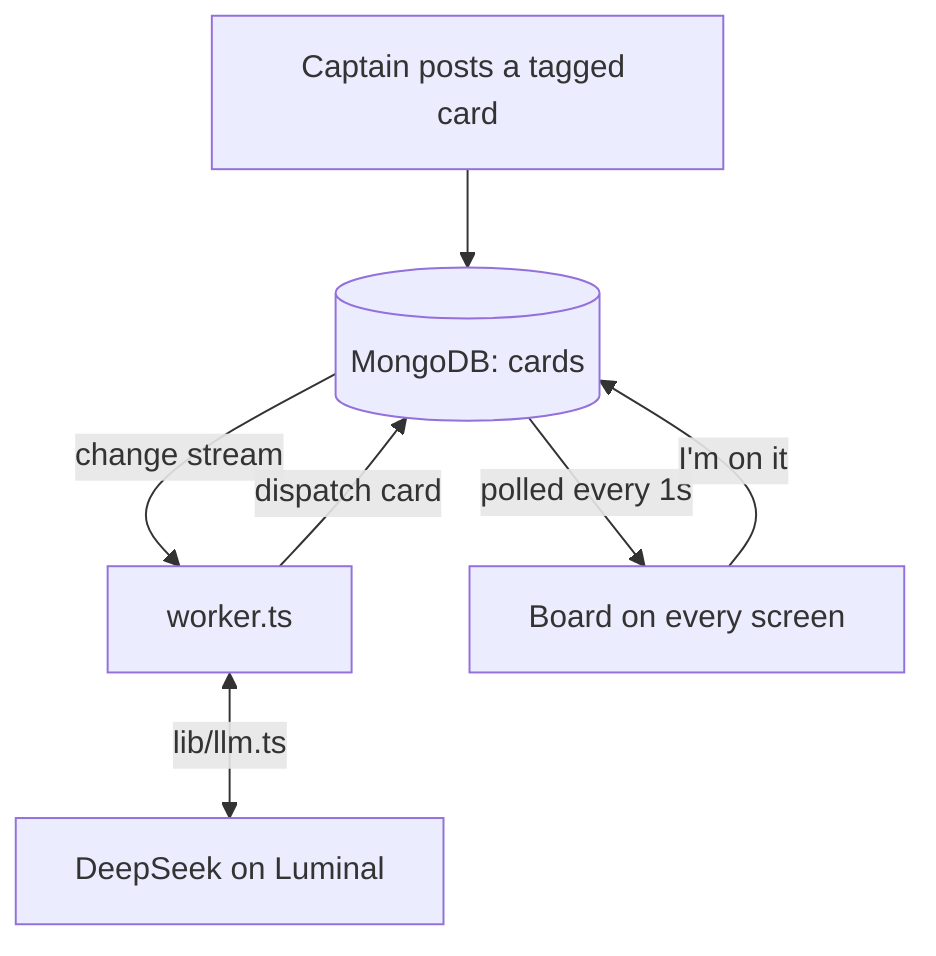
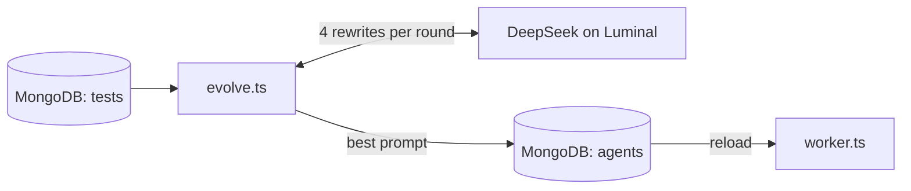

# 🟣 Huddle

**A live shared board where THON captains and AI agents work the floor together. Agents wake up on MongoDB change streams, and they get better every round.**

> Built in one day at **c0mpiled-15 @ Penn State** for THON, Penn State's 46-hour dance marathon *For The Kids*.

**"AI is single-player. Huddle is where a team and its agents work together, live."**

🎥 **Demo video:** _link coming_ &nbsp;·&nbsp; 📈 **Evolve results:** run the app and open [`/evolve`](#-self-improving-agents-evolve)

---

<details>
<summary><b>📑 Contents</b></summary>

- [The problem](#-the-problem)
- [How it works](#-how-it-works)
- [Meet the agents](#-meet-the-agents)
- [Try it yourself](#-try-it-yourself)
- [Self-improving agents (evolve)](#-self-improving-agents-evolve)
- [Architecture & tech stack](#-architecture--tech-stack)
- [Run it locally](#-run-it-locally)
- [Prize tracks](#-prize-tracks)
- [Challenges & what we learned](#-challenges--what-we-learned)
- [What's next](#-whats-next)
- [Team](#-team)

</details>

---

## 💡 The problem

THON is the largest student-run philanthropy in the world: hundreds of dancers stay on their feet for 46 hours while thousands of student volunteers keep them safe, fed and motivated. On the floor, coordination runs through group chats:

- **Requests get buried.** "Section 112 needs water" scrolls away under 50 other messages.
- **Nobody knows who owns what.** Two volunteers run to the same spill, and nobody goes to the next one.
- **Last-minute changes break the plan.** When a First Aid lead drops out at 3am, who's the backup? Who needs to be told?
- **AI tools are single-player.** A chatbot in one captain's pocket doesn't help the other 200 people on the floor.

## 🔧 How it works

1. **A captain posts a card** with a tag: `#medical`, `#supplies`, `#schedule`, and so on.
2. **The right agent wakes up on its own, with no prompting.** Each agent's trigger is a MongoDB filter on a change stream, so inserting the card *is* the trigger.
3. **The agent posts a dispatch card:** urgency · who is assigned and their backup · a ready-to-send message.
4. **A captain clicks "I'm on it"**, and their name shows on every screen within a second.
5. **Need a new kind of help?** Describe an agent in one sentence. It joins the board, gets its own tag button, and answers the next matching card.
6. **Agents improve.** `evolve.ts` rewrites an agent's prompt, scores it on tests, and proves the gain on held-out tests it never saw.

```text
Captain:        #schedule  Priya can't make her overnight First Aid shift
🔁 Shift Planner: URGENT · Priya out, Marcus now owns overnight First Aid; emergency plan
                updated · Send: 'Marcus, Priya can't make her overnight First Aid shift;
                you're covering her station overnight. Reply YES to confirm.'
Captain Devon:  [I'm on it]  →  "✓ Devon is on it" on every screen
```

## 🤖 Meet the agents

One agent per tag, each modeled on a THON committee. Every reply follows the same shape: urgency, who goes and their backup, and the exact message to send.

| Agent | Tag | Handles |
|---|---|---|
| 🟣 **Alex** | `#request` | General triage for anything: names the issue type and severity (`critical` / `urgent` / `routine`). **Its prompt was improved by evolve.** |
| 🏥 **MedAlert** | `#medical` | Collapses, allergic reactions, injuries, panic attacks |
| 🔄 **SwapBot** | `#substitute` | A dancer has to step out: picks an available backup from the dancer roster in the same block and swaps them in |
| 🛡️ **Security** | `#security` | Lost children, fire alarms, fights, unattended bags, intruders, rule reminders |
| 📦 **Supplies** | `#supplies` | Water, food, dietary needs, blankets and socks, First Aid restocks |
| 🛠️ **Ops** | `#logistics` | Spills, power outages, sound and lights, bathrooms, accessibility ramps, shuttles |
| 🎉 **Hype** | `#morale` | Low-energy sections, homesick dancers, music requests, mail call |
| 🔁 **Shift Planner** | `#schedule` | Volunteer dropouts, both leads out (escalates to the captain on duty), events that move; keeps the emergency plan current |
| 📣 **Outreach** | `#outreach` | Texts to families (kept private), emails to donors, press, social posts, PA announcements |

…plus any agent your team spawns from a sentence during the event.

<details>
<summary><b>Real replies from our live tests</b></summary>

```text
#request   Alex       supplies, urgent — dancer in Section 112 needs water, grabbing a bottle and heading there now.
#security  Security   CRITICAL · Jordan + BJC event security, backup Sam · Send: 'Jordan, fire alarm going off on concourse, alert BJC security and initiate evacuation now.'
#supplies  Supplies   URGENT · Maya, backup Chris · Send: 'Maya, bring one sealed gluten-free meal to the dancer's section now…'
#logistics Ops        URGENT · Devon, backup Riley · Send: 'Devon, wheelchair ramp at Gate C is blocked, clear it now and keep area accessible.'
#morale    Hype       URGENT · Aisha, backup Ben · Send: 'Aisha, Section 118 dancer is homesick and crying; bring mail call letters from home…'
#schedule  Shift Pl.  SOON · Hospitality lead Maya and backup Chris both out for 2am; escalate to Captain Taylor to reassign coverage…
#outreach  Outreach   ROUTINE · Elena, backup Noah · Send (private text to family): 'Hi, this is Elena from THON. Your dancer is resting with our First Aid team and is being well cared for…'
#medical   MedAlert   Medical moderate — dancer in panic attack in Block B, I'm sending a first aid responder now…
```

</details>

## 🧪 Try it yourself

Open the board in **two browser windows** with two different names, then post these. Pick the tag button first.

| Tag | Post this | Who answers |
|---|---|---|
| `request` | Section 112 dancer needs water | 🟣 Alex |
| `medical` | Dancer dizzy and nauseous in Zone 5 | 🏥 MedAlert |
| `security` | Unattended backpack under Section 105 | 🛡️ Security |
| `supplies` | Section 130 needs dry socks | 📦 Supplies |
| `logistics` | Gatorade spill near Block A | 🛠️ Ops |
| `morale` | Section 220 losing steam at hour 30 | 🎉 Hype |
| `schedule` | Priya can't make her overnight First Aid shift | 🔁 Shift Planner |
| `outreach` | Thank-you email to donors for hour 40 | 📣 Outreach |
| `substitute` | Blake Williams backing out, section 204 | 🔄 SwapBot |

Then:
- [ ] In the **other window**, click **I'm on it** on an agent's reply and watch the name appear in both.
- [ ] Spawn an agent: *"An agent that handles accessibility requests like wheelchair seating and ASL interpreters."* A new `#accessibility` button appears. Post with it and the new agent answers.
- [ ] Open **`/evolve`** to see how Alex improved.

## 📈 Self-improving agents (evolve)

`npm run evolve -- Alex` runs up to 5 rounds:

1. Run the agent on its **train** tests and collect the failures.
2. Ask DeepSeek (on Luminal) for **4 rewritten prompts in parallel**, each aimed at fixing those failures.
3. Score all 4 on the train tests. Keep the best one **only if it beats the current prompt.**
4. At the end, score the winner on **held-out tests that the optimizer never saw**, save it to MongoDB (the live agent updates instantly), and write `evolve-results.json` for the `/evolve` page.

**Our run on Alex** (tests check the issue type plus a THON severity word, `critical` / `urgent` / `routine`, which the original prompt never mentioned):

| | Baseline | After evolve |
|---|---|---|
| Train tests | 0 / 12 | **11 / 12** (12/12 on the round-3 recheck, so it stopped early) |
| **Held-out tests (never seen)** | 1 / 6 | **4 / 6** |

<details>
<summary><b>Round by round</b></summary>

| Step | Train passed | Result |
|---|---|---|
| Baseline | 0/12 | — |
| Round 1 | 11/12 | Improved, kept |
| Round 2 | 11/12 | No gain, kept previous |
| Round 3 | 12/12 on recheck | All train tests pass, stopped early |

What it learned, in its own words: *"Every reply must clearly include the issue type and urgency level… critical for collapse, unresponsive, or life-threatening; urgent for pain, dizziness, hydration/water needs, wet-floor hazards…"*

The raw run is in [`evolve-log.txt`](evolve-log.txt), and the numbers are in [`evolve-results.json`](evolve-results.json).

</details>

## 🧱 Architecture & tech stack

**1. The live loop:** a card goes in, the right agent answers, a captain takes it.



**2. The evolve loop:** agents get better between rounds.



- **Frontend:** Next.js (App Router) + TypeScript, plain CSS, Framer Motion. The board polls `/api/state` every second: no websockets, no auth.
- **Database:** MongoDB Atlas, database `huddle`. Collections: `cards`, `agents`, `tests`, `feed`, `dancers`, `events`.
- **Reactive agents:** `scripts/worker.ts` opens one change stream per agent. An agent's trigger is literally a MongoDB filter, e.g. `{ "operationType": "insert", "fullDocument.tag": "security" }`. An atomic `findOneAndUpdate` lock means each card gets exactly one agent. Agents only *add* cards, and the worker skips cards written by agents, so agents never trigger themselves.
- **LLM:** `lib/llm.ts` is the only place LLM calls happen. It talks to Luminal's OpenAI-compatible API (DeepSeek V4.1 Flash).
- **Self-improvement:** `scripts/evolve.ts`, scored against the `tests` collection (`train` / `heldout`).
- **Data:** `template.json` holds the agents, starter cards, dancer roster and tests. `npm run seed` loads it.

<details>
<summary><b>Project structure</b></summary>

```text
app/
  page.tsx                  the live board
  evolve/page.tsx           evolve results page
  api/state                 everything the board shows (polled every 1s)
  api/cards                 post a card
  api/cards/[id]/claim      "I'm on it"
  api/agents/generate       spawn an agent from one sentence
  api/events                schedule / calendar
lib/
  db.ts                     getDb() for the "huddle" database
  llm.ts                    the only LLM entry point (Luminal)
scripts/
  worker.ts                 change streams → agents
  evolve.ts                 self-improvement loop
  seed.ts                   loads template.json
template.json               agents, starter cards, dancers, tests
evolve-results.json         latest evolve run (read by /evolve)
```

</details>

## 🚀 Run it locally

You need Node 20+, a MongoDB Atlas cluster with your IP on its access list, and a Luminal API key.

```bash
git clone https://github.com/sayang7/huddle && cd huddle
npm install
cp .env.local.example .env.local      # then put in your own values
npm run seed                          # loads template.json (resets the board)
npm run worker                        # run exactly ONE worker
npm run dev                           # open http://localhost:3000
```

| Variable | What it is |
|---|---|
| `MONGODB_URI` | Your Atlas connection string |
| `LLM_BASE_URL` | Luminal's OpenAI-compatible endpoint |
| `LLM_API_KEY` | Your Luminal key |
| `LLM_MODEL` | The DeepSeek model name on Luminal |

To improve an agent, run `npm run evolve -- Alex` and open `/evolve`.

> ⚠️ Run **one** worker. Two workers on the same database answer every card twice. Running `seed` after `evolve` resets the evolved prompt to whatever is in `template.json`.

## 🏆 Prize tracks

| Track | How Huddle fits |
|---|---|
| **YC RFS Fall 2026: Multiplayer AI** | One live board the whole team watches. Agents dispatch, humans claim ("I'm on it"), and anyone can steer by spawning a new agent in one sentence. |
| **Luminal: Self-Improving Agent Team** | `evolve.ts` runs 4 prompt candidates in parallel per round on DeepSeek via Luminal: baseline, then improving rounds, then held-out proof (**1/6 → 4/6**). |
| **MongoDB: Highest-Aura Use** | Change streams *are* the agent runtime. Each trigger is a stored MongoDB filter, adding an agent is inserting a document, and an atomic `findOneAndUpdate` gives each card exactly one agent. |

## 🧗 Challenges & what we learned

- **Blank agent replies.** DeepSeek reasons before it answers. With `max_tokens: 400`, the reasoning used up the whole budget, so cards came back cut off or empty. We raised it to 4000 and now refuse to post an empty reply.
- **Evolve that couldn't evolve.** The optimizer step needs about 1,500 tokens of reasoning, so its rewrites came back empty and every "candidate" was the old prompt. The same fix applied.
- **Tests that were too easy.** Our first tests only checked the issue type, which Alex always said, so it scored 12/12 at baseline and there was nothing to learn. Adding THON's severity rule gave evolve a real target.
- **Rate limits.** Luminal returned 429s at around 16 parallel calls, and evolve was firing 24. We capped it at 4 and added a short pause before retrying.
- **Four workers, one card.** Teammates were running workers on different laptops, so every card got answered several times. Lesson: one worker, plus an atomic lock.
- **Agents claimed everything.** Once every tag had an agent, captains had nothing left to claim. Now captains claim the agent's dispatch card, which was the workflow we wanted all along.
- **Spawned agents had no button.** The tag buttons were hard-coded, so a new `#accessibility` agent could never be triggered. The buttons now come from the live agents.
- **Three people, one `template.json`.** Parallel edits and a re-seed from an old local copy wiped agents mid-afternoon. Pull before you seed.

## 🔭 What's next

- Actually send the drafted messages (SMS or Slack) after a captain approves them
- Sync rosters and shifts from THON's real volunteer system, not a static list
- Run evolve on every agent automatically, using real incidents as new tests
- Committee roles and sign-in, so the right people see the right cards
- An after-event report: response times, busiest sections, coverage gaps

## 👥 Team

| | Role |
|---|---|
| **Sayan Gupta** ([@sayang7](https://github.com/sayang7)) | Core app: the board UI, worker and change streams, API routes, dancer roster, calendar |
| **Shivaan Bhalla** ([@Shivaan2007](https://github.com/Shivaan2007)) | Luminal setup and the agent spawn route |
| **Tejasv Agarwal** ([@TJA0308](https://github.com/TJA0308)) | Committee agents, tests and evolve, the `/evolve` page, pitch, video and submission |

<p align="center"><b>For The Kids. 💛</b></p>
